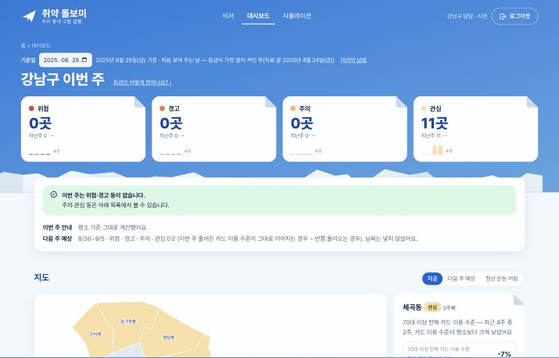
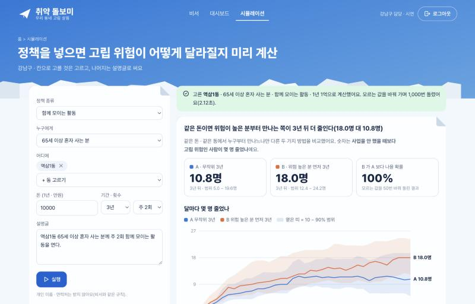
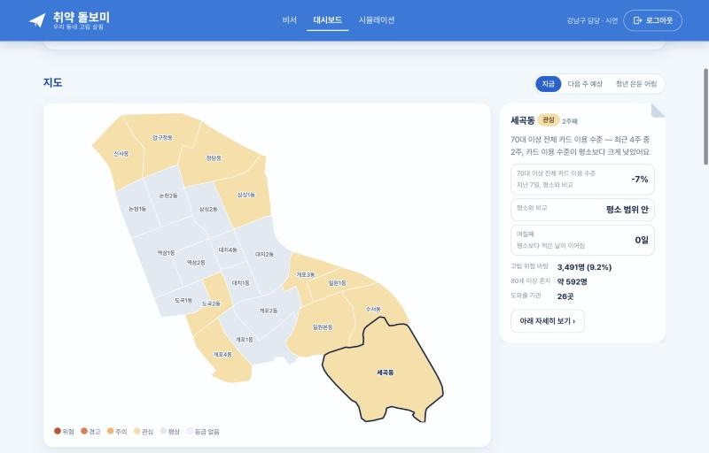
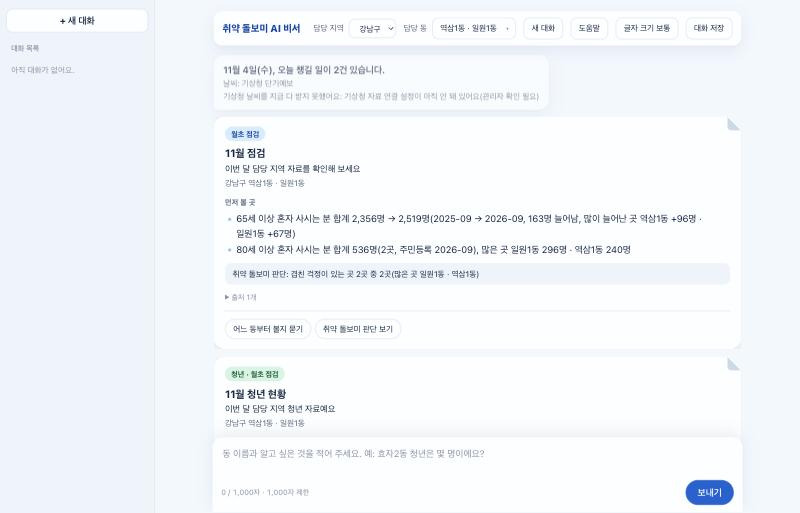
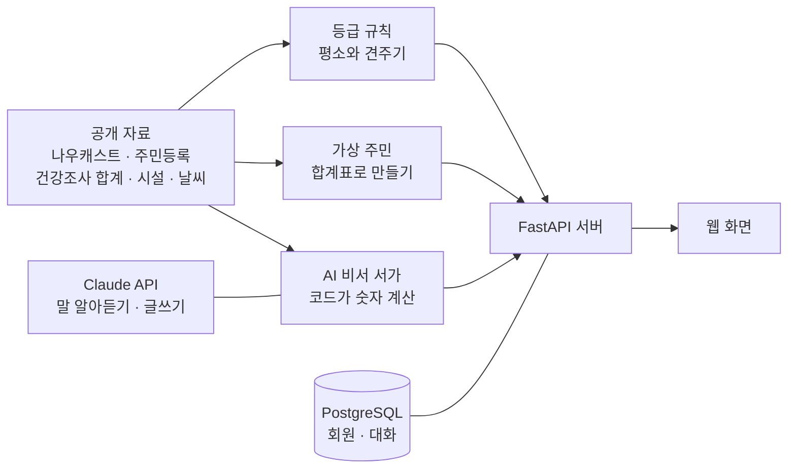

# 취약 돌보미

[](https://github.com/yangjungun05-prog/isolation-care-public/actions/workflows/ci.yml)

**복지 실무자가 "어느 동부터, 왜, 무엇을 하면 얼마나"를 자료로 판단하게 돕는 서비스입니다.**

고독사 담당 인력 251명이 전국 229개 시군구를 맡고 있고, 그중 이 일만 하는 사람은 70명입니다(제1차 고독사 예방 기본계획, 2022년 10월 기준). 사람을 더 찾아내는 도구가 아니라, 적은 인력이 먼저 갈 곳을 정하도록 돕는 도구를 만들었습니다.

> **공개판 안내:** 2026 빅콘테스트 AI데이터 활용 분야에 낸 프로젝트의 코드를 공개 자료로 다시 돌린 판입니다. 대회 제공 자료는 들어 있지 않아 **화면 숫자가 대회판과 다르고, 대시보드 민감도는 더 낮습니다.** [무엇이 달라졌는지](#대회판과-달라진-점) · [얼마나 믿을 수 있는지](#성능과-한계)를 먼저 봐 주세요.

**[▶ 사용 영상 보기 (2분 17초 · 자막 있음 · 소리 없음)](docs/demo.mp4)**

| 대시보드 | 시뮬레이션 |
|---|---|
|  |  |
| **동 지도와 이유** | **AI 비서** |
|  |  |

## 무엇을 하나요

| 기능 | 하는 일 | 답하는 질문 |
|---|---|---|
| **대시보드** | 카드 이용이 평소보다 많이 낮은 주를 세어 동별 등급과 방문 순서를 냅니다 | 이번 주 어느 동부터 갈까? |
| **시뮬레이션** | 사업 종류 · 대상 · 동 · 돈 · 기간을 넣으면 3년 뒤 고립 위험이 몇 명 줄지 범위로 냅니다 | 이 돈이면 얼마나 줄까? 누구부터 만날까? |
| **AI 비서** | 담당 동을 말로 묻고, 날씨 · 연휴 앞 카드와 동 상황 문서를 받습니다 | 우리 동 상황이 어떤가? |
| **회원** | 이메일 인증 가입 · 로그인 · 담당 동 · 대화 기록 | |

**개인은 찾지도 판정하지도 않습니다.** 모든 숫자는 동이나 집단 단위입니다. 정보를 건네고, 판단은 현장이 합니다.

## 어떻게 동작하나요



- **대시보드:** 지난 4주의 가운데 값을 평소로 삼고, 평소 범위 바닥보다 낮은 주를 셉니다. 최근 4주 중 2주면 관심, 3주 이상이면 주의입니다. 구 단위 값은 그 나이 비율이 높은 동에 나눠 붙입니다.
- **시뮬레이션:** 가상 주민이 달마다 고립에 빠지고 벗어납니다. 같은 주사위로 사업을 한 동네와 안 한 동네를 비교해 사업 덕분인 몫만 셉니다. 모르는 값 50벌 × 주사위 20벌, 1,000번 돌려 범위로 보여 주고, 실행 순서는 LangGraph가 맡습니다.
- **AI 비서:** 질문 하나가 8단계를 지납니다. 개인정보 가리기 → 질문 이해(AI) → 답할지 정하기 → 길 고르기 → 숫자 계산 → 답변 쓰기(AI) → 답 검사 → 기억입니다.

**숫자는 코드가 계산하고, AI는 말을 알아듣고 글을 쓰는 일만 합니다.** 보고서에 옮겨 적을 숫자가 틀리면 쓸 수 없기 때문입니다.

## 바로 실행하기

[uv](https://docs.astral.sh/uv/)와 Docker가 필요합니다.

```bash
git clone https://github.com/yangjungun05-prog/isolation-care-public.git
cd isolation-care-public
cp .env.example .env
docker compose up -d
uv sync
uv run alembic upgrade head
uv run python -m src.auth.seed
```

터미널 두 개에서 서버를 켭니다.

```bash
uv run uvicorn src.api.main:app --port 8000
```

```bash
uv run uvicorn src.api.assistant:app --port 8010
```

http://localhost:8000 을 열어 가입합니다. 기본 설정은 메일을 실제로 보내지 않으니, 인증번호는 http://localhost:8000/api/auth/dev/outbox 에서 확인합니다.

| `.env` 값 | 없으면 |
|---|---|
| `ANTHROPIC_API_KEY` | 대시보드 · 시뮬레이션은 돌아갑니다. 비서는 AI가 필요한 답을 하지 못합니다 |
| `DATA_GO_KR_SERVICE_KEY` | 날씨 카드의 실시간 예보를 받지 못합니다 |

## 대회판과 달라진 점

| 대회판 | 공개판 | 달라지는 점 |
|---|---|---|
| 신한카드 결제 | [나우캐스트 신용카드 이용금액](https://www.data.go.kr/data/15120835/fileData.do) | 날짜별 → 주별, 금액 → 기준 시점 대비 수준, 나이 × 업종 → 60대 · 70대 이상 두 줄, 2026-04-24까지 |
| SKT 유동인구 | 없음 | 대체할 공개 자료가 없어 뺐습니다 |
| 건강조사 응답자 줄 | 전국 약 46만 명 합계표(36칸, 칸 최소 86명) | 칸 안에서는 사람을 구분하지 못합니다 |

바꾸면서 직접 재 보고 내린 결정입니다.

- **나이 × 업종 줄은 어림하지 않았습니다.** 나이 값과 업종 값을 곱해 만들면 흔들림이 커져, 아무 일 없는 줄의 16%에서 경보가 울렸습니다.
- **등급 규칙을 '7일 중 며칠'에서 '4주 중 몇 주'로 바꿨습니다.** 주 값을 7일로 펼친 자료에 옛 규칙을 쓰면 아무 일 없는 줄의 21%에서 울렸습니다.
- **고립 비율은 강남 응답자가 아니라 전국 합계로 만들었습니다.** 강남 응답자 중 기초수급은 17명뿐이라 칸을 만들 수 없었습니다.

## 성능과 한계

2026-11-04에 이 저장소의 자료로 잰 값입니다.

**대시보드:** 마지막 4주를 일부러 줄인 가짜 줄을 넣어 쟀습니다(4줄 × 22날 = 88번, 2025-11-28 ~ 2026-04-24). 화면의 '등급은 어떻게 정하나요?'에 나오는 표와 같습니다.

| 줄인 정도 | 관심 이상으로 잡음 | 주의 이상으로 잡음 |
|---|---|---|
| 안 줄임(오탐) | 0% | 0% |
| 10% | 0% | 0% |
| 20% | 26.1% | 5.7% |
| 30% | 53.4% | 23.9% |
| 40% | 86.4% | 56.8% |
| 60% | 100% | 98.9% |

고르는 날에 따라 달라집니다. 2025-08-01 ~ 12-26으로 재면 오탐 2.3%, 30% 감소 63.6%입니다.

**시뮬레이션:** 65세 이상 혼자 사는 분 · 함께 모이는 활동 · 1년 1억 · 3년, 3년 뒤 줄어든 사람(가운데 값)입니다.

| 동 | 아무나 만나면 | 위험 높은 칸 먼저 | 값 50벌 중 더 나은 횟수 |
|---|---|---|---|
| 역삼1동 | 10.8명 | 18.0명 | 50 |
| 세곡동 | 10.0명 | 14.3명 | 46 |
| 일원1동 | 14.0명 | 15.8명 | 40 |
| 신사동 | 10.0명 | 10.0명 | 8 |
| 사북면(춘천) | 4.0명 | 4.5명 | 22 |
| 남산면(춘천) | 8.3명 | 6.5명 | 6 |

**꼭 알아 둘 한계입니다.**

- **고립을 직접 재지 않습니다.** 카드 이용이 줄어든 것이 곧 고립은 아닙니다. 실제 고립 · 고독사와 맞는지는 동 단위 정답 자료가 없어 확인하지 못했습니다.
- **작은 감소는 대부분 놓칩니다.** 2025-09-23 ~ 12-31 실제 자료(4줄 × 100일)는 전부 평상이고, 2023-06 ~ 2026-04 전체에서 등급이 켜진 주는 3번뿐입니다.
- **동 등급은 추정입니다.** 구 전체 값을 나이 구성으로 붙였을 뿐, 그 동에서 실제로 줄었다는 뜻이 아닙니다.
- **춘천 읍면 시뮬레이션은 참고하지 마세요.** 응답자 줄로 계산한 대회판(사북면 2.0명 대 2.0명)과 차이가 크고, 남산면은 순서가 뒤집힙니다.
- **효과와 비용은 빌린 값입니다.** 다른 연구와 사업에서 가져온 값이라 강남구에서 그대로 나온다는 보장이 없습니다.
- **고립 추정 모델은 들어 있지 않습니다.** 원자료로 학습한 LightGBM 코드와 응답자 단위 결과는 뺐고, 동별 비율 합계만 있습니다.

## 시험과 검사

```bash
DATABASE_URL=postgresql+psycopg://user:x@localhost:1/none uv run pytest
uv run python scripts/check_public.py
```

- 시험 1,000개 이상을 Mac과 GitHub Actions(Linux)에서 돌립니다.
- `check_public.py`는 대회 자료 · 응답자 줄 · API 키 · 개인 메일이 저장소에 없는지 봅니다. `--self-test`로 나쁜 파일을 실제로 잡는지도 확인합니다.
- 비서의 AI 응답 시험(질문 이해 362/363, 긴 대화 475/477)은 원본 저장소에서 2026-10-28에 잰 값이고, 공개판에서 다시 돌리지는 않았습니다.

## 폴더

```text
src/
  dashboard/   등급 규칙 · 동에 나눠 붙이기
  simulation/  가상 주민 · 계산 · 설명글
  assistant/   AI 비서
  auth/        회원
  api/         FastAPI 서버
web/           대시보드 · 시뮬레이션 · 로그인 화면
data/
  public/          시설 · 인구 · 날씨 등 공개 자료
  derived_public/  대시보드 · 시뮬레이션 재료
  processed/       동별 고립 위험 합계
scripts/       자료 만들기 · 공개 전 검사
evals/ tests/  시험지 · 자동 시험
```

**기술:** Python 3.12 · FastAPI · PostgreSQL 18 · SQLAlchemy · Alembic · LangGraph · pandas · numpy · Claude API · HTML · CSS · JavaScript · uv · ruff · pytest

## 자료 출처

- **카드 이용:** 국가데이터처 나우캐스트 포털 지표 데이터(공공데이터포털 15120835, 이용허락범위 제한 없음)
- **고립 비율 합계:** 질병관리청 지역사회건강조사 2023 · 2025 원시자료를 가공한 결과입니다. 응답자 단위 자료는 넣지 않았고, 응답자가 30명 미만인 동은 세부 비율을 싣지 않았습니다. 분석 결과는 질병관리청과 무관하며 책임은 작성자에게 있습니다.
- **인구:** 행정안전부 주민등록 인구
- **그 밖의 자료:** [`data/public/SOURCES.md`](data/public/SOURCES.md) · 화면 아이콘과 사진은 [`web/assets/CREDITS.md`](web/assets/CREDITS.md)
- **대회 제공 자료(신한카드 · SKT):** 원자료도, 그것으로 만든 값도 넣지 않았습니다.

## 만든 사람

- **김정준** (팀장): AI 비서 · 회원 · 자료 조사
- **양정운**: 대시보드 · 시뮬레이션 · 고립 추정 · 개발 환경

## 라이선스

별도 라이선스를 정하지 않았습니다. 코드를 재사용하려면 먼저 문의해 주세요.
